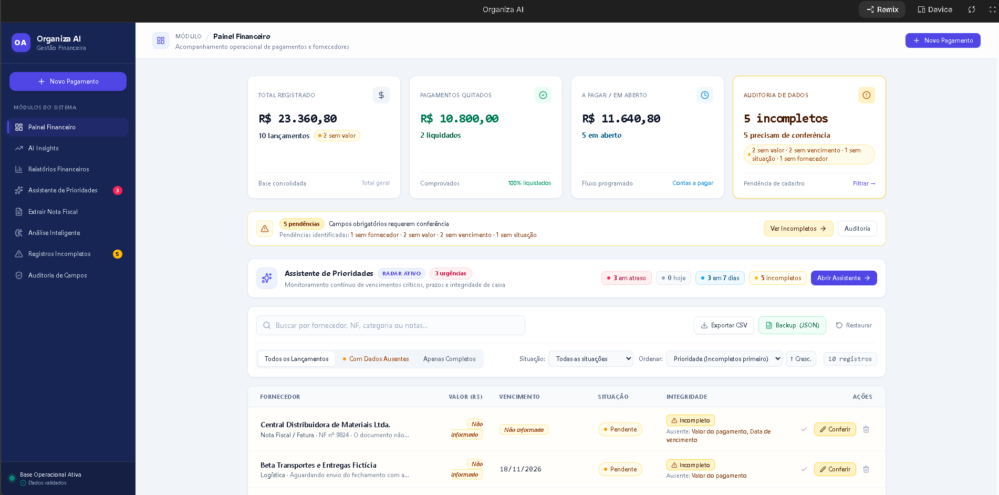
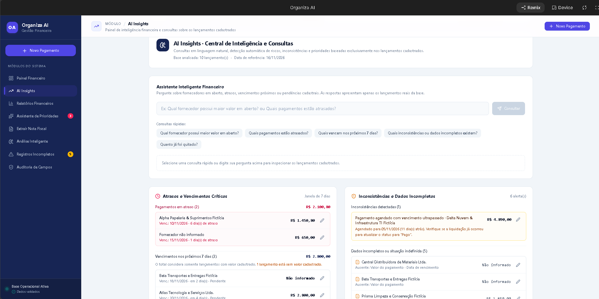
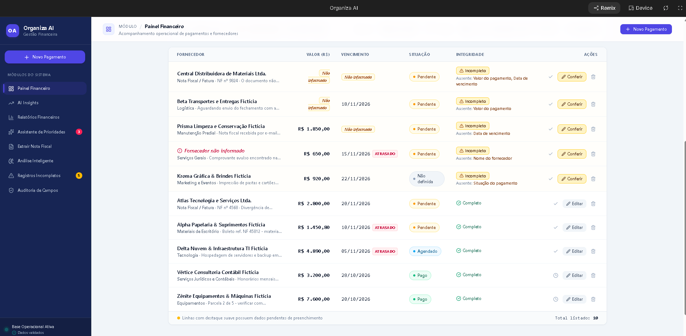

# Organiza AI (AI Organize)

> **Assistente administrativo e financeiro para organização, conferência e controle de pagamentos a fornecedores.**

O Organiza AI é uma aplicação full-stack desenvolvida como projeto de portfólio para demonstrar a aplicação de tecnologia, inteligência artificial e validações determinísticas em rotinas administrativas e financeiras.

A ferramenta permite organizar lançamentos, acompanhar vencimentos, identificar registros incompletos, analisar possíveis divergências e consultar informações financeiras por meio do módulo AI Insights.

O projeto utiliza dados fictícios e combina recursos automatizados com regras locais de validação e conferência humana, mantendo o operador responsável pelas decisões e confirmações.

---

## 📑 Sumário

- [Visão Geral e Objetivo](#-visão-geral-e-objetivo)
- [Demonstração do Projeto](#-demonstração-do-projeto)
- [Principais Funcionalidades](#-principais-funcionalidades)
- [Ecossistema AI Finance Hub](#-ecossistema-ai-finance-hub)
- [Arquitetura do Sistema](#-arquitetura-do-sistema)
- [Tecnologias Utilizadas](#-tecnologias-utilizadas)
- [Pré-requisitos](#-pré-requisitos)
- [Instalação e Configuração](#️-instalação-e-configuração)
- [Scripts Disponíveis](#-scripts-disponíveis)
- [Armazenamento e Privacidade](#-armazenamento-e-privacidade)
- [Avisos e Dados de Demonstração](#️-avisos-e-dados-de-demonstração)
- [Licença](#-licença)

---

## 🎯 Visão Geral e Objetivo

O Organiza AI foi desenvolvido para explorar soluções tecnológicas aplicadas a desafios comuns das rotinas administrativas e financeiras, especialmente no processo de contas a pagar.

Entre os cenários considerados no desenvolvimento estão:

- Pagamentos potencialmente duplicados;
- Ausência de informações importantes sobre fornecedores ou documentos;
- Perda de prazos e falta de visibilidade sobre datas de vencimento;
- Divergências entre valores registrados em documentos financeiros;
- Dificuldade de acompanhar pagamentos pendentes e registros incompletos.

A aplicação funciona como uma ferramenta de apoio à organização e análise financeira. Os recursos automatizados auxiliam na identificação de informações e inconsistências, mas a conferência e a validação final permanecem sob responsabilidade do usuário.

---

## 🎬 Demonstração do Projeto

As demonstrações apresentam a interface da aplicação, os recursos de organização financeira e o módulo AI Insights.

### Painel Financeiro e funcionalidades



O painel reúne indicadores financeiros, acompanhamento de lançamentos e recursos para organização das contas a pagar.

**Vídeo:** [▶ Assistir à demonstração do Painel Financeiro](./evidencias/demonstração1.mp4)

### AI Insights — Inteligência Financeira



Módulo de análise financeira com consultas em linguagem natural, identificação de pendências e apoio à priorização de pagamentos.

**Vídeo:** [▶ Assistir à demonstração do AI Insights](./evidencias/demonstração-iai-insights.mp4)

### Tabela Operacional



Visualização dos lançamentos financeiros, com informações para acompanhamento e controle operacional.

---

## 🚀 Principais Funcionalidades

### 1. Painel Financeiro

- Indicadores de valores pagos, valores a pagar, lançamentos pendentes, atrasados e registros incompletos;
- Visualização consolidada da situação financeira;
- Tabela operacional com ordenação, pesquisa textual e filtros;
- Cadastro e edição de lançamentos;
- Validação de campos obrigatórios.

### 2. Assistente de Prioridades Financeiras

- Classificação de pagamentos por situação temporal:
  - Atrasados;
  - Vencendo hoje;
  - Próximos 7 dias;
  - Mais de 7 dias;
- Identificação de registros incompletos;
- Indicação de informações pendentes de confirmação;
- Simulação de data de referência para análise dos vencimentos.

### 3. Extração de Informações de Notas Fiscais

- Inserção de textos extraídos de notas fiscais, DANFEs, boletos, ordens de serviço e recibos;
- Identificação de campos como CNPJ, razão social, número do documento, valores e vencimentos;
- Organização das informações extraídas para conferência;
- Indicação de informações ausentes ou conflitantes;
- Necessidade de revisão humana antes da utilização dos dados no controle financeiro.

**Integração com IA:** o projeto possui uma estrutura de integração com a API Google Gemini no backend. A utilização desse recurso depende de uma chave de API válida e de configuração adequada. Quando a integração externa não está disponível, existem regras locais de contingência para auxiliar no processamento de informações.

### 4. Regras Locais de Validação e Identificação de Divergências

- Validações determinísticas implementadas localmente;
- Identificação de campos obrigatórios ausentes;
- Análise de possíveis divergências entre valores e vencimentos;
- Sinalização de informações que precisam de conferência;
- Separação entre dados identificados e dados que ainda precisam ser confirmados.

### 5. Auditoria e Detecção de Duplicidades

- Conferência da integridade dos registros;
- Identificação de possíveis lançamentos duplicados;
- Comparação de informações como fornecedor, valor, vencimento e número do documento;
- Sinalização de registros que merecem revisão.

### 6. Relatórios Financeiros

- Visualização analítica dos lançamentos;
- Distribuição de despesas por situação de pagamento;
- Organização de informações por categoria e centro de custo, quando disponíveis;
- Exportação de registros em formato CSV para utilização em planilhas.

### 7. AI Insights — Assistente de Inteligência Financeira

Módulo integrado à aplicação, desenvolvido para facilitar a consulta e a interpretação das informações financeiras.

Entre os recursos previstos e demonstrados estão:

- Consultas em linguagem natural sobre os lançamentos;
- Identificação de fornecedores com maiores valores em aberto;
- Consulta de pagamentos atrasados e vencimentos próximos;
- Identificação de inconsistências e registros incompletos;
- Apoio à análise e à priorização de pagamentos com base nos dados disponíveis.

As respostas devem ser interpretadas como apoio à análise, não como substituição da conferência financeira ou da tomada de decisão humana.

### 8. Backup e Restauração em JSON

- Exportação de uma cópia dos registros em formato JSON;
- Restauração de dados por meio de arquivo de backup;
- Verificação da estrutura dos dados antes da restauração;
- Apoio à preservação dos registros armazenados na aplicação.

---

## 🔄 Ecossistema AI Finance Hub

O AI Finance Hub é um ecossistema de projetos de portfólio que explora a aplicação de inteligência artificial, automação e análise de dados em processos administrativos e financeiros.

O ecossistema é composto por três módulos complementares:

| Projeto | Descrição |
|---|---|
| **AI Organize** | Aplicação para organização de documentos, fornecedores, pagamentos e vencimentos. |
| **AI Flow** | Automação desenvolvida com n8n para recebimento, extração e validação de informações de notas fiscais, registro em planilha e apoio ao acompanhamento de vencimentos. |
| **AI Insights** | Módulo de análise financeira integrado ao AI Organize, com consultas, identificação de inconsistências e apoio à tomada de decisão. |

Os componentes demonstram diferentes possibilidades de aplicação tecnológica em processos administrativos e financeiros, utilizando cenários e dados fictícios.

---

## 🏗 Arquitetura do Sistema

O Organiza AI utiliza uma arquitetura full-stack, com frontend e backend organizados em camadas.

### Visão simplificada da arquitetura

```text
┌──────────────────────────────────────────────────────┐
│                 FRONTEND                             │
│                                                      │
│             React 19 + TypeScript                     │
│                    + Vite                             │
│                                                      │
│  • Interface e componentes                            │
│  • Tabelas, filtros e formulários                     │
│  • Painel financeiro e relatórios                     │
│  • Módulo AI Insights                                 │
│  • Regras locais de validação                         │
│  • Armazenamento no localStorage                      │
└──────────────────────────┬───────────────────────────┘
                           │
                     Requisições HTTP
                        /api/*
                           │
┌──────────────────────────▼───────────────────────────┐
│                  BACKEND                              │
│                                                      │
│                Node.js + Express                      │
│                                                      │
│  • Rotas de processamento                             │
│  • Integração com serviços de IA                      │
│  • Gerenciamento de variáveis de ambiente             │
│  • Comunicação entre frontend e serviços externos     │
└──────────────────────────┬───────────────────────────┘
                           │
                    Integração opcional
                           │
┌──────────────────────────▼───────────────────────────┐
│               GOOGLE GEMINI API                      │
│                                                      │
│  • Apoio à extração de informações                    │
│  • Processamento de conteúdo                          │
└──────────────────────────────────────────────────────┘
```

### Segurança da chave de API

A aplicação foi estruturada para manter a variável `GEMINI_API_KEY` no ambiente do backend.

- A chave não deve ser inserida diretamente no código do frontend;
- As credenciais devem ser armazenadas em arquivo `.env` local;
- O arquivo `.env` deve permanecer no `.gitignore`;
- O arquivo `.env.example` deve conter apenas nomes de variáveis e valores ilustrativos, nunca credenciais reais.

---

## 🛠 Tecnologias Utilizadas

### Frontend

- React 19
- TypeScript
- Vite
- Tailwind CSS
- Lucide React

### Backend

- Node.js
- Express
- TypeScript
- tsx
- dotenv

### Inteligência Artificial

- Google Gemini API
- Google Gen AI SDK (`@google/genai`)

### Armazenamento e dados

- localStorage
- JSON
- CSV

### Ferramentas de desenvolvimento

- Visual Studio Code
- Git
- GitHub
- npm

---

## 📋 Pré-requisitos

Para executar o projeto localmente, é necessário possuir:

- Node.js (versão 18 ou superior; recomenda-se uma versão LTS compatível com as dependências);
- npm (gerenciador de pacotes instalado junto ao Node.js);
- Git para clonar o repositório.

---

## ⚙️ Instalação e Configuração

### 1. Clonar o repositório

```bash
git clone https://github.com/lorranesmmartins-dot/ai-organize.git
```

Acesse a pasta do projeto:

```bash
cd ai-organize
```

### 2. Instalar as dependências

```bash
npm install
```

### 3. Configurar as variáveis de ambiente

Crie um arquivo `.env` na raiz do projeto, utilizando o `.env.example` como referência.

Exemplo:

```env
GEMINI_API_KEY="sua_chave_gemini_aqui"
PORT=3000
```

A variável `GEMINI_API_KEY` deve receber uma chave válida, caso o usuário queira configurar a integração com o Google Gemini.

**Importante:** não compartilhe ou publique sua chave de API. O arquivo `.env` deve permanecer ignorado pelo Git.

### 4. Executar a aplicação

```bash
npm run dev
```

Após iniciar o servidor, acesse no navegador:

```text
http://localhost:3000
```

A aplicação será executada localmente em ambiente de desenvolvimento.

---

## 🖥 Scripts Disponíveis

Os comandos devem ser executados a partir da pasta raiz do projeto.

| Comando | Descrição |
|---|---|
| `npm run dev` | Inicia o servidor Express integrado ao Vite em modo de desenvolvimento. |
| `npm run build` | Gera os arquivos de build do frontend na pasta `dist/`. |
| `npm start` | Inicia o servidor em modo de produção, conforme a configuração do projeto. |
| `npm run lint` | Executa a verificação estática de tipos TypeScript, conforme o script configurado. |
| `npm run clean` | Remove os arquivos de build e artefatos gerados, conforme o script configurado. |
| `npm run preview` | Permite visualizar localmente o build gerado pelo Vite. |

---

## 🔒 Armazenamento e Privacidade

### Armazenamento local

Os registros financeiros da aplicação são armazenados no navegador do usuário por meio do `localStorage`, utilizando a chave:

```text
organiza_ai_pagamentos_v1
```

Isso permite manter os dados entre sessões no mesmo navegador, sem depender de um banco de dados remoto para o armazenamento principal dos registros.

### Privacidade

- Os dados de demonstração são fictícios;
- O projeto não foi desenvolvido para receber documentos financeiros reais;
- As credenciais de serviços externos devem permanecer no backend;
- Não devem ser inseridos dados pessoais, financeiros ou empresariais sensíveis em ambientes de demonstração.

### Backup

Como os registros ficam armazenados localmente no navegador, recomenda-se utilizar a funcionalidade de backup em JSON para preservar os dados de demonstração.

---

## ⚠️ Avisos e Dados de Demonstração

### Dados fictícios

Todos os nomes de fornecedores, CNPJs, números de documentos, datas e valores utilizados nos registros e cenários de demonstração são fictícios.

O conteúdo foi criado exclusivamente para fins educacionais, testes e apresentação do projeto em portfólio.

### Limitações e conferência humana

O Organiza AI é um projeto demonstrativo de apoio administrativo e financeiro.

A aplicação não substitui sistemas contábeis ou financeiros corporativos, nem a análise de profissionais habilitados.

As informações extraídas, classificações, sugestões e possíveis divergências devem ser conferidas antes de qualquer utilização em processos reais.

### Ambiente de execução

O projeto foi desenvolvido para execução local. A publicação do código no GitHub não significa que a aplicação esteja hospedada ou disponível como serviço online.

---

## 📄 Licença

Este projeto é distribuído sob os termos da licença Apache 2.0.

Consulte o arquivo [LICENSE](./LICENSE) para obter mais informações.
